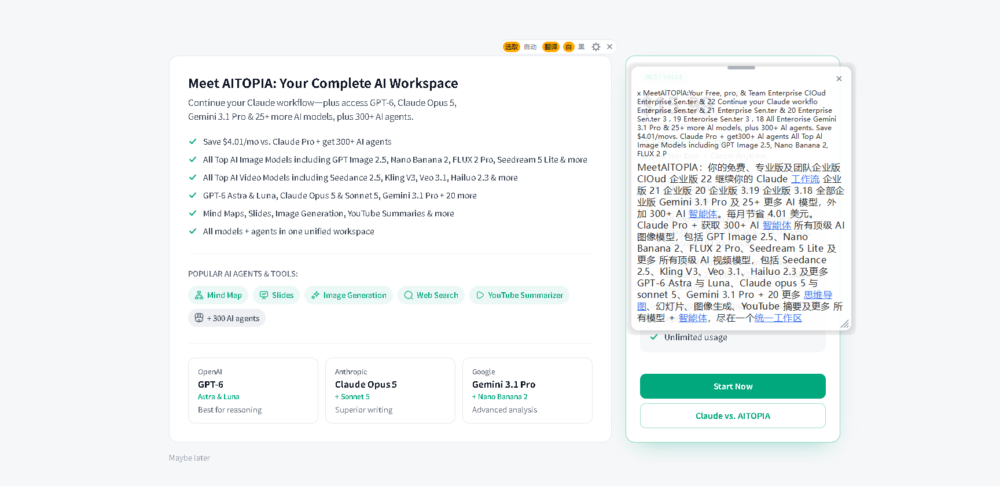

# RectTranslate

[中文](README.md) | English

A Windows desktop translation tool. Keep a resizable rectangle on screen and get live translations of its contents, or select text in any app and press a global hotkey.

The UI is currently Chinese.



*Frame any part of the screen to keep translating it; high-confidence terms in the translation are highlighted in blue and open a web search when clicked.*

## Features

- **Persistent rectangle**: move and resize it freely; translations refresh when the content changes, or click "翻译" on the control bar to translate once.
- **Selection translation**: select text and press the global hotkey (default `Ctrl+Shift+Q`). Uses the clipboard, not OCR, and restores the clipboard afterwards.
- **Two providers**: a free public endpoint, or DeepSeek (bring your own API key).
- **Term links**: professional terms, memes, and paper/classic references in the translation are highlighted in blue; clicking opens a search (Bing by default).
- **Independent popup**: semi-transparent, light/dark themes, draggable via the top handle, resizable, remembers its position.
- **History**: the last 50 manual/selection translations, viewable, copyable, and clearable from the tray.
- **Long text**: the popup caps at 75% of the screen height and scrolls beyond that.
- **Tray-first**: closing the control bar hides to the tray; launching again reveals the existing frame.
- **Adjustable frame**: four colors, three thicknesses, three lengths.
- **OCR**: 2× upscale before recognition; auto mode runs both Chinese and English Windows OCR engines and picks the better result. Right-click the frame to force a language.
- **HiDPI**: capture uses the window's physical pixel rect, so 125%/150% scaling does not crop the wrong region.

## Requirements

- Windows 10 2004+ or Windows 11
- Python 3.12+ (developed on 3.14)
- The Windows OCR language pack(s) for the languages you read

## Install and run

```powershell
git clone https://github.com/hzc54188hzc-ctrl/rect-translate.git
cd rect-translate
python -m venv .venv
.\.venv\Scripts\python.exe -m pip install -r requirements.txt
.\.venv\Scripts\python.exe 01-run.py
```

The first run creates `config.local.json` automatically and uses the **free provider**, so no API key is required.

## Portable build (Windows x64)

No Python required: download `RectTranslate-win64.zip` from [Releases](https://github.com/hzc54188hzc-ctrl/rect-translate/releases), unzip it, and run `RectTranslate.exe`. The first run also creates `config.local.json`.

To install a desktop shortcut:

```powershell
powershell -NoProfile -File tools\05-install-shortcut.ps1
```

## Usage

| Action | How |
| --- | --- |
| Translate the rectangle | Click "翻译" on the control bar, double-click the frame, or right-click → translate once |
| Move the frame | Drag the bend of a corner boomerang |
| Resize the frame | Drag a boomerang arm (diagonal) or an edge midpoint capsule (single edge) |
| Translate selected text | Select text, then press `Ctrl+Shift+Q` |
| Move the popup | Drag the capsule at the top center of the popup |
| Hide to tray | Click × on the control bar, or press `Esc` |
| Quit | Tray icon → Quit |
| History | Tray icon → History |
| Settings (hotkey, appearance, provider) | Gear icon on the control bar |

## Using DeepSeek

Settings → provider → DeepSeek, then paste an API key starting with `sk-`. The key is stored only in the local `config.local.json` and is never uploaded. Keep the free provider if you do not have a key.

On transient failures the app retries once; if the model provider still fails, it falls back to the free provider and says so in the popup.

## Privacy

- Screenshots are recognized **locally** with Windows OCR. Recognized text is sent to the translation service you choose (Google's public endpoint for the free provider, DeepSeek for the model provider).
- Selection translation simulates `Ctrl+C`, then restores the clipboard exactly (including images, files, and HTML).
- History is stored locally in `history.json` (manual/selection only, up to 50 entries) and can be cleared from the history window.
- No telemetry; no configuration upload; the API key is stored in plain text in the local config file.

## Known limitations

- Windows only; OCR depends on installed language packs.
- Small, dense, or dark-on-dark text may still be misrecognized.
- The free provider uses an unofficial public endpoint and may rate-limit or stop working.
- HiDPI capture is handled, but multi-monitor setups should still be verified in practice.
- Term highlighting is model judgment and may include false positives or misses; clicking opens a search, not an authoritative explanation.

## Project layout

```text
.
├─ 01-run.py            entry point
├─ recttrans/           app code (frame, capture, OCR, translation, popup, tray, settings)
├─ tests/               regression and self-check scripts
├─ tools/               shortcut and icon helpers
├─ requirements.txt
└─ config.example.json  (config.local.json is generated on first run)
```

## Development

```powershell
.\.venv\Scripts\python.exe tests\run_all.py
```

`run_all.py` runs the tests that do not need network access or a real screen/OCR. `tests\14-settings-check.py` (network) and `tests\15-text-selection.ps1` (manual) are run separately. CI is defined in `.github/workflows/tests.yml`.

## License

MIT. See [LICENSE](LICENSE) and [THIRD_PARTY_NOTICES.md](THIRD_PARTY_NOTICES.md).
